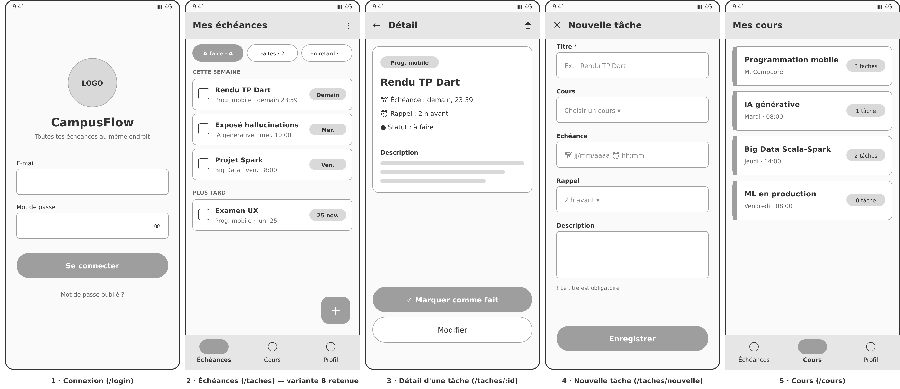
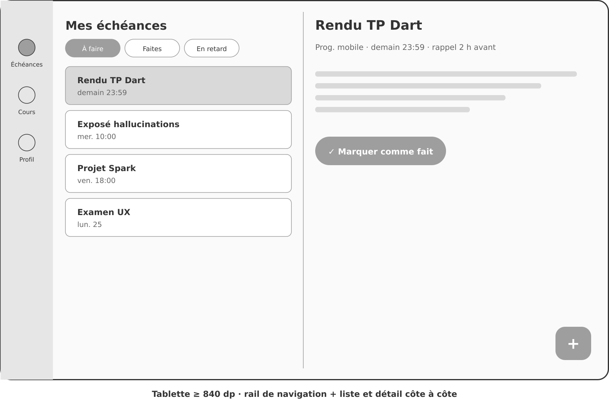
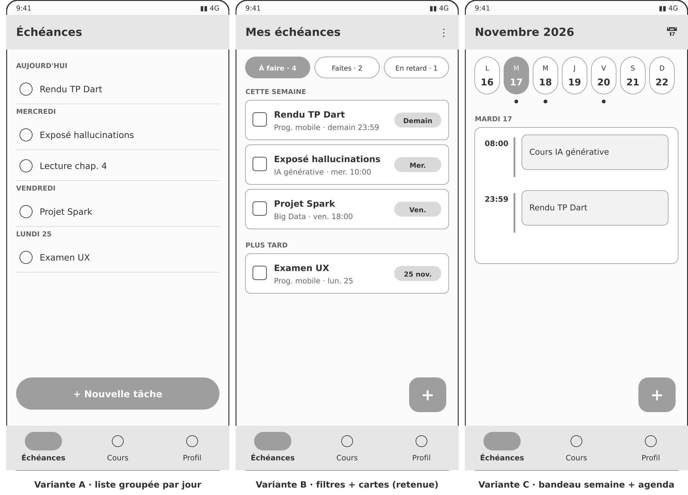

# Séance 2 · TP 3 — Wireframes et choix de variante

Wireframes basse fidélité (gris, sans couleur), au format téléphone de 360 × 800 dp. Les images sont dans le dossier `wireframes/`.

## Les 5 écrans

| # | Écran | Fichier | Rôle dans le parcours |
|---|---|---|---|
| 1 | Connexion | `01-connexion.png` | Accès au compte (séance 7) |
| 2 | Échéances | `02-echeances.png` | Planifier, consulter |
| 3 | Détail d'une tâche | `03-detail.png` | Rendre (« Marquer comme fait ») |
| 4 | Nouvelle tâche | `04-nouvelle-tache.png` | Ajouter, être rappelée |
| 5 | Cours | `05-cours.png` | Organiser les tâches par cours |

Bonus : la version tablette d'au moins 840 dp (`06-tablette-840dp.png`) montre la liste et le détail côte à côte, avec un rail de navigation. Elle prépare le TP de la séance 5.

## Brief utilisé pour explorer les variantes (méthode du cours : 6 éléments)

> **Contexte :** application mobile CampusFlow, suivi des échéances académiques d'étudiants d'Afrique francophone.
> **Utilisateur :** Fatimata, M1 Informatique, Android d'entrée de gamme utilisé d'une main, connexion souvent coupée.
> **Tâche :** voir ce qui est dû cette semaine, repérer ce qui est en retard, ajouter une tâche en 3 appuis au maximum.
> **Contraintes :** 360 × 800 dp, Material 3, cibles de 48 dp, contraste AA (4,5:1), en français.
> **Format :** 3 variantes de l'écran « Échéances », en wireframes basse fidélité.
> **Style :** sobre, gris, un seul accent, grille visible.

## Les 3 variantes de l'écran « Échéances »

- **A — Liste groupée par jour :** lignes simples avec une case ronde, regroupées sous « Aujourd'hui », « Mercredi »… et un grand bouton « Nouvelle tâche » en bas.
- **B — Filtres et cartes :** trois puces de filtre (À faire, Faites, En retard) avec leur compteur, des cartes de tâche (titre, cours, date, badge d'échéance) et un bouton flottant « + ».
- **C — Bandeau semaine et agenda :** sélecteur de jour en haut, puis une frise horaire du jour choisi.

## Évaluation avec la grille du cours

Notes de 1 (faible) à 3 (fort).

| Critère | Question | A | B | C |
|---|---|:-:|:-:|:-:|
| **Besoin** | Répond-elle aux job stories (voir la semaine, repérer le retard) ? | 2 : la semaine est visible, mais rien ne signale le retard | **3** : « En retard » visible en un appui, avec son compteur | 1 : un seul jour à la fois, aucune vue d'ensemble |
| **Parcours** | Le chemin est-il court ? (ajout : nombre d'appuis) | 3 : bouton visible, 3 appuis | **3** : FAB à portée du pouce, 3 appuis | 2 : il faut d'abord choisir le jour |
| **Accessibilité** | Contraste, cibles de 48 dp, libellés | 2 : cases rondes petites, cours non affiché | **3** : cartes de 64 dp, case de 48 dp, badges textuels (pas seulement de la couleur) | 2 : les jours de 40 dp de large sont trop petits pour une cible de 48 dp |
| **Faisabilité Flutter** | Composants connus ? | 3 : `ListView` + `ListTile` | **3** : `FilterChip`, `ListView.builder`, `Card`/`ListTile`, `FloatingActionButton`, `NavigationBar` | 2 : frise horaire sur mesure, plus coûteuse |
| **Cohérence** | Réutilise le design system ? | 2 | **3** : réutilise la carte de tâche et le bouton | 2 |
| **Total** | | 12 | **15** | 9 |

## Décision : variante B retenue

La variante B répond directement aux deux job stories. La seconde demande de voir la semaine et de repérer le retard : le filtre « En retard » et son compteur rendent l'urgence visible sans chercher. L'ajout reste à 3 appuis grâce au bouton flottant, placé là où tombe le pouce d'une utilisatrice qui tient son téléphone d'une main.

Elle n'utilise que des widgets standard de Material 3, donc elle est **réalisable en séance 5**. Ses trois filtres correspondent exactement au fournisseur dérivé demandé en séance 6 (à faire, faites, en retard).

La variante C est séduisante, mais elle masque la vue d'ensemble de la semaine, qui est le besoin principal. La variante A est simple, mais elle ne met pas le retard en évidence.

> L'IA a servi à explorer les structures possibles. Le choix final repose sur la grille ci-dessus et sur le persona.
