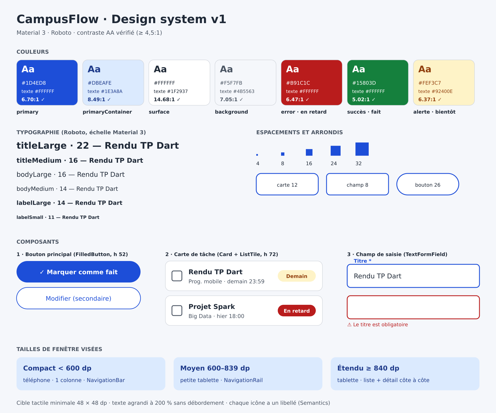

# Séance 2 · TP 4 — Design system v1

Page de référence visuelle : `design-system-v1.png`



## 1. Couleurs (tokens)

Contraste calculé avec la formule WCAG 2.x (luminance relative). Seuil requis : **4,5:1** pour le texte courant.

| Token | Fond | Texte posé dessus | Contraste | Usage |
|---|---|---|:-:|---|
| `primary` / `onPrimary` | `#1D4ED8` | `#FFFFFF` | **6,70:1** ✓ | Bouton principal, FAB, filtre actif |
| `primaryContainer` / `onPrimaryContainer` | `#DBEAFE` | `#1E3A8A` | **8,49:1** ✓ | Puce de cours, élément sélectionné |
| `surface` / `onSurface` | `#FFFFFF` | `#1F2937` | **14,68:1** ✓ | Cartes, texte principal |
| `background` / `onSurfaceVariant` | `#F5F7FB` | `#4B5563` | **7,05:1** ✓ | Fond d'écran, texte secondaire |
| `error` / `onError` | `#B91C1C` | `#FFFFFF` | **6,47:1** ✓ | Badge « En retard », erreurs de formulaire |
| `success` / `onSuccess` | `#15803D` | `#FFFFFF` | **5,02:1** ✓ | Badge « Fait » |
| `warning` / `onWarning` | `#FEF3C7` | `#92400E` | **6,37:1** ✓ | Badge « Demain » ou « Bientôt » |

> Le statut d'une tâche n'est **jamais signalé par la couleur seule** : chaque badge contient un mot (« En retard », « Fait »…). Les personnes daltoniennes peuvent donc le lire.

## 2. Typographie

Police : **Roboto**, la police par défaut de Material sous Android. Aucune police à télécharger, ce qui économise la data.

| Style Material 3 | Taille | Graisse | Usage |
|---|---|---|---|
| `titleLarge` | 22 sp | Bold | Titre d'écran (AppBar), titre du détail |
| `titleMedium` | 16 sp | Bold | Titre d'une carte de tâche |
| `bodyLarge` | 16 sp | Regular | Texte des champs, description |
| `bodyMedium` | 14 sp | Regular | Sous-titre (cours et date) |
| `labelLarge` | 14 sp | Medium | Libellés de boutons |
| `labelSmall` | 11 sp | Medium | Badges, en-têtes de section (« CETTE SEMAINE ») |

Les tailles sont en **sp** : elles suivent la taille de texte choisie dans le système. L'écran doit rester utilisable avec le texte à 200 %, donc **pas de hauteurs fixes** sur les éléments qui contiennent du texte.

## 3. Espacements et arrondis

- **Espacements :** 4 · 8 · 16 · 24 · 32 dp. La marge d'écran standard est de 16 dp.
- **Arrondis :** carte 12 dp · champ 8 dp · bouton 26 dp (pilule).
- **Cible tactile minimale :** 48 × 48 dp.

## 4. Trois composants

| Composant | Widget Flutter | Spécification |
|---|---|---|
| **Bouton principal** | `FilledButton` | Hauteur 52 dp, pilule, fond `primary`, libellé `labelLarge`. Le bouton secondaire est un `OutlinedButton` de même forme. |
| **Carte de tâche** | `Card` + `ListTile` | Hauteur d'environ 72 dp, arrondi 12, case à cocher à gauche (zone d'appui de 48 dp), titre `titleMedium`, sous-titre « cours · date » en `bodyMedium`, badge d'échéance à droite. |
| **Champ de saisie** | `TextFormField` (`OutlineInputBorder`) | Hauteur 56 dp, arrondi 8, libellé au-dessus, bordure `primary` au focus, bordure et message en `error` si le validator échoue. |

## 5. Tailles de fenêtre visées (classes Material 3)

| Classe | Largeur | Structure CampusFlow |
|---|---|---|
| Compact | < 600 dp | Téléphone : une colonne, `NavigationBar` en bas |
| Moyen | 600 à 839 dp | Petite tablette ou pliable : `NavigationRail` à gauche |
| Étendu | ≥ 840 dp | Tablette : liste et détail côte à côte (seuil du TP de la séance 5) |

## 6. Traduction prévue en Flutter (séance 4)

```dart
ThemeData(
  useMaterial3: true,
  colorScheme: ColorScheme.fromSeed(seedColor: Color(0xFF1D4ED8)).copyWith(
    primary: Color(0xFF1D4ED8),
    error: Color(0xFFB91C1C),
    surface: Color(0xFFFFFFFF),
  ),
  scaffoldBackgroundColor: Color(0xFFF5F7FB),
  cardTheme: CardThemeData(shape: RoundedRectangleBorder(borderRadius: BorderRadius.circular(12))),
  inputDecorationTheme: InputDecorationTheme(border: OutlineInputBorder(borderRadius: BorderRadius.circular(8))),
);
```
